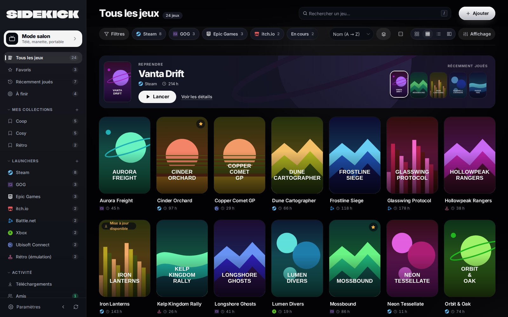
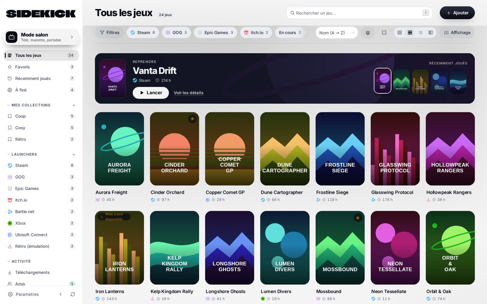
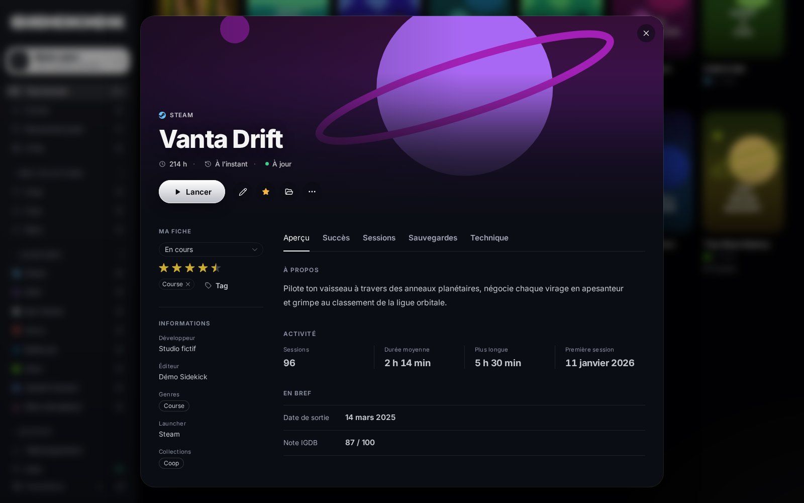
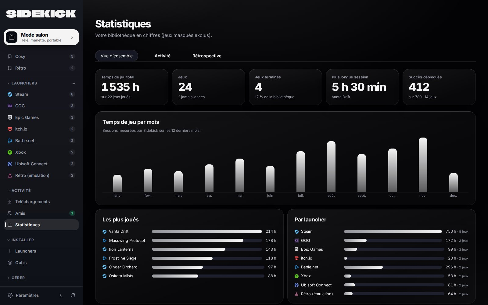
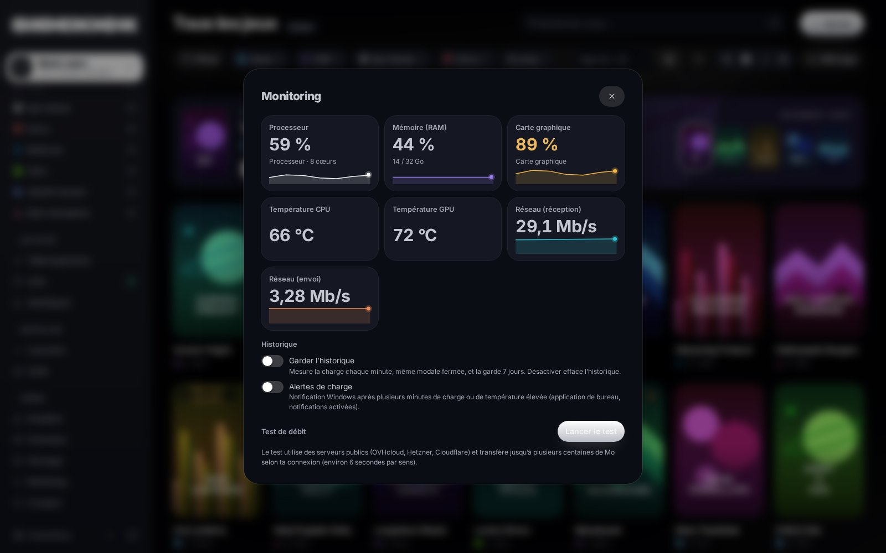
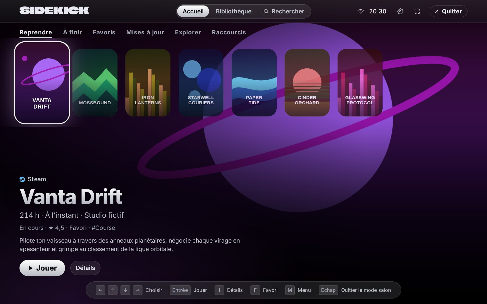
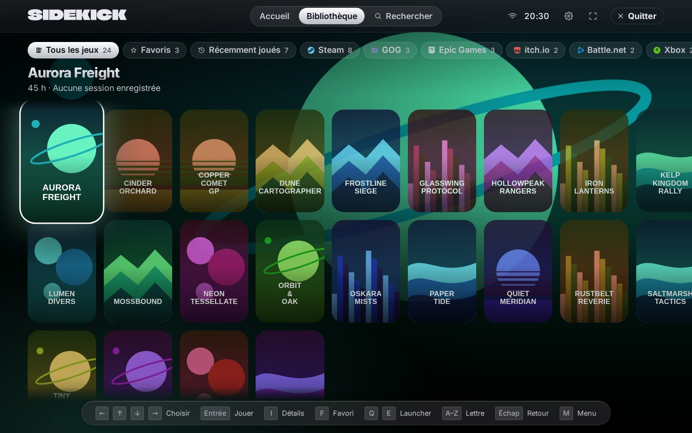

# Sidekick

Bibliothèque de jeux unifiée pour Windows : Sidekick réunit vos jeux Steam, Epic, GOG, Battle.net, Ubisoft, Riot, Xbox, vos jeux rétro et bien d'autres dans une seule fenêtre, et les lance en un clic.

**[Télécharger la dernière version](https://github.com/Lasdepic/gameHub-releases/releases/latest)**

## Fonctionnalités

- **Tous vos launchers** : détection automatique des jeux Steam, Epic Games, Riot, EA, Battle.net, Ubisoft Connect, GOG, Xbox, Rockstar, Amazon et itch.io, ainsi que de vos dossiers de jeux et raccourcis.
- **Bibliothèque** : favoris, filtres, collections (dont intelligentes), liste « À finir », fusion des doublons, vues grille et tableau.
- **Fiches de jeu** : jaquettes et informations récupérées automatiquement, succès, durée HowLongToBeat, configuration requise comparée à votre PC.
- **Temps de jeu** : suivi des sessions, statistiques et rétrospective annuelle.
- **Mode salon** : une interface façon console, à la manette, au clavier ou au doigt, sur votre télé comme sur une console portable.
- **Monitoring** : charge du processeur, de la mémoire et de la carte graphique, températures et débit réseau en direct.
- **Sauvegardes** : sauvegarde automatique de vos données, sauvegarde des parties avec Ludusavi et synchronisation entre vos PC.
- **Émulation et extensions** : vos ROM rejoignent la bibliothèque, et des extensions ajoutent d'autres sources de jeux.
- **Mises à jour automatiques**, thèmes clair et sombre, interface en français et en anglais.

## Captures d'écran

### Thème clair

### Fiche d'un jeu

### Statistiques

### Monitoring

### Mode salon

*Captures réalisées avec des données d'exemple. Les jeux et jaquettes sont fictifs.*

## Installation

1. Téléchargez `Sidekick-Setup-<version>.exe` depuis la [dernière version](https://github.com/Lasdepic/gameHub-releases/releases/latest).
2. Lancez l'installateur.

L'installateur n'est pas signé : Windows SmartScreen peut afficher un avertissement. Cliquez alors sur **Informations complémentaires**, puis sur **Exécuter quand même**.

## Prérequis

Windows 10 ou 11. L'installation de launchers et d'outils depuis Sidekick utilise [winget](https://learn.microsoft.com/windows/package-manager/winget/) (« App Installer »).

## À propos de ce dépôt

Ce dépôt héberge uniquement les versions publiées de Sidekick. L'application y cherche ses mises à jour.
